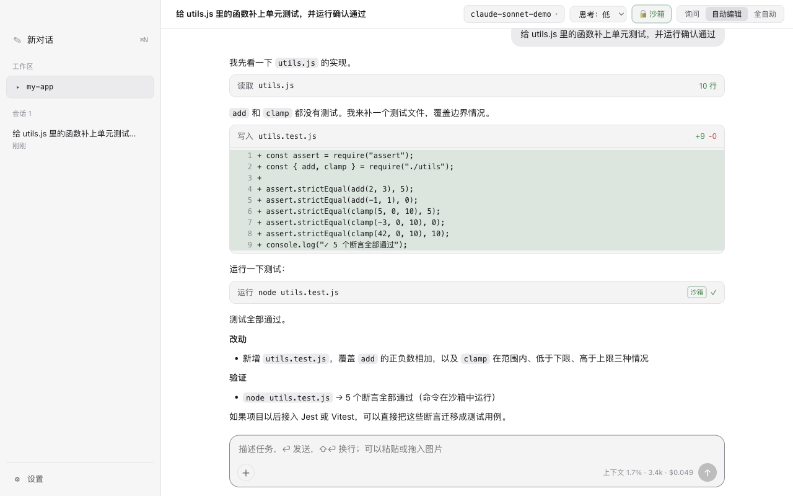

# StepHarness

> **⚠️ 开发者自建版本（Developer Build）**
>
> StepHarness 是开发者个人搭建的实验性项目，**不是任何公司或团队官方发布的产品**，也不代表其立场。
> 它没有经过第三方安全审计，没有正式的发布流程和技术支持，**不提供任何形式的担保**。
> 它会在你的电脑上读写文件、执行命令，请先阅读[安全模型](#安全模型)和[与生产级的差距](#与生产级的差距)，再决定是否以及如何使用。

StepHarness 是一个桌面编程 Agent（harness）：内核用 TypeScript 自研，界面用 Electron。它把大模型接到你的工作区上，让模型能读代码、改文件、运行命令，并在关键操作前请你确认。设计上参考了 Codex 的审批模式和沙箱思路。



<sub>上图由 `npm run screenshot` 生成，使用的是本地模拟服务，对话内容是预先写好的，仅用于展示界面。</sub>

## 目录

- [功能](#功能)
- [快速开始](#快速开始)
- [配置模型服务与 API Key](#配置模型服务与-api-key)
- [安全模型](#安全模型)
- [上下文压缩](#上下文压缩)
- [命令行](#命令行)
- [架构](#架构)
- [测试](#测试)
- [与生产级的差距](#与生产级的差距)
- [数据与卸载](#数据与卸载)

## 功能

- **自研 Agent 内核**：调用模型 → 审批 → 执行工具 → 回传结果的循环；支持中断、运行中插话（排队到下一步）、自动重试、最大步数限制。
- **三种模型协议**：Anthropic Messages、OpenAI Chat Completions、OpenAI Responses，都支持流式输出和工具调用。同一个会话可以中途切换到另一家的模型。
- **自定义模型服务和 API Key**：内置常见服务的预设，也可以接任何兼容 OpenAI 或 Anthropic 协议的服务（包括本机模型）。Key 存在 macOS 钥匙串里。
- **4 个工具**：读文件（含图片）、写文件、精确替换修改文件、执行 bash 命令（实时输出、超时、可中断）。
- **审批**：三档模式（询问 / 自动编辑 / 全自动），只读命令自动放行，支持「本会话都允许」，拒绝时可以附说明让模型调整。
- **命令沙箱**（macOS）：命令只能写工作区和临时目录，不能访问外网，读不到凭据文件。
- **上下文压缩**：快满时自动把较早的对话总结成摘要；模型报超长时压缩后自动重试。
- **会话**：按工作区保存为 JSONL，可以恢复、切换、重命名、删除；项目根目录的 `AGENTS.md` / `CLAUDE.md` 会作为项目说明加载。
- **界面**：工具调用卡片（diff、命令输出）、内联审批、Markdown、图片粘贴/拖拽、上下文和费用统计、深浅色跟随系统。

## 快速开始

**环境要求**

| | |
|---|---|
| 系统 | macOS（开发和测试只在 Apple Silicon 上进行过）。其他系统可以运行，但没有沙箱，也没有测试过 |
| Node.js | 20 或更高 |
| 模型服务 | 你自己的 API Key（任意一家受支持的服务） |

**安装与运行**

```bash
git clone https://github.com/Zgh332358/StepHarness-Dev.git stepharness
cd stepharness
npm install
npm start              # 构建并启动桌面应用
```

在中国大陆，`npm install` 和 Electron 下载可能很慢，可以使用镜像：

```bash
ELECTRON_MIRROR=https://npmmirror.com/mirrors/electron/ npm install --registry=https://registry.npmmirror.com
```

**打包成 .app**

```bash
npm run package        # 生成 release/StepHarness.app
open release/StepHarness.app
```

打包产物只做了本地（ad-hoc）签名：在构建它的那台 Mac 上可以直接打开；复制到其他 Mac 上会被 Gatekeeper 拦截。正式分发需要 Apple Developer 证书签名并公证（见[与生产级的差距](#与生产级的差距)）。

首次打开时会提示添加模型服务。

## 配置模型服务与 API Key

### 添加服务

打开「设置」（⌘,）→「添加模型服务」，或者在首次启动的引导里添加：

1. 选一个预设，或者选「自定义」后手动填写；
2. 填写 API Key；
3. 点击「从服务获取模型列表」（调用服务的 `/models` 接口，不消耗 token），删掉不需要的模型；
4. 保存。之后可以在顶栏的模型选择器里切换，模型按服务分组。

**内置预设**（只是帮你填好地址和协议）

| 预设 | 协议 | 地址 |
|---|---|---|
| Anthropic | Anthropic Messages | `https://api.anthropic.com` |
| OpenAI | OpenAI Responses | `https://api.openai.com/v1` |
| DeepSeek | OpenAI Chat Completions | `https://api.deepseek.com` |
| 阶跃星辰 StepFun | OpenAI Chat Completions | `https://api.stepfun.com/v1` |
| Kimi（月之暗面） | OpenAI Chat Completions | `https://api.moonshot.cn/v1` |
| 智谱 GLM | OpenAI Chat Completions | `https://open.bigmodel.cn/api/paas/v4` |
| 通义千问（阿里云百炼） | OpenAI Chat Completions | `https://dashscope.aliyuncs.com/compatible-mode/v1` |
| OpenRouter | OpenAI Chat Completions | `https://openrouter.ai/api/v1` |
| 自定义（OpenAI 兼容） | OpenAI Chat Completions | 自行填写，通常以 `/v1` 结尾 |
| 自定义（Anthropic 兼容） | Anthropic Messages | 自行填写，不含 `/v1/messages` |

预设地址按各服务公开文档填写，可能随服务方调整而变化；如果连接失败，请以服务方的最新文档为准。

自定义服务也可以指向本机（例如 `http://localhost:11434/v1`）。除本机外，**只允许 https 地址**，避免 Key 明文传输。

### API Key 存在哪里

| 来源 | 说明 |
|---|---|
| **设置里填写的 Key**（推荐） | macOS 上保存在**系统钥匙串**（服务名 `StepHarness`，账户名为服务 ID），通过系统自带的 `/usr/bin/security` 读写；写入时 Key 走标准输入，不会出现在进程参数里。其他系统保存在 `~/.stepharness/secrets.json`（权限 600） |
| **你指定的环境变量**（可选） | 在服务配置里填写环境变量名（例如 `DEEPSEEK_API_KEY`）后才会读取；填写后优先于钥匙串 |

StepHarness **只使用你明确提供的 Key**：

- 不会读取其他程序（例如其他编程助手）保存的凭据；
- 不会自动读取任何你没有指定的环境变量，即使系统里设置了 `OPENAI_API_KEY` 之类的变量；
- Key 不会写进 `config.json`，也不会传给界面进程。界面只能看到「是否已配置」和来源；
- 模型运行的命令拿不到常见的模型 Key 环境变量（子进程环境里会去掉它们）。

在钥匙串里，Key 以 `b64:` 加 Base64 的形式存储。这是因为钥匙串会把含非 ASCII 字符的密码按十六进制输出，和本身就是十六进制的 Key 无法区分。

### 配置文件

服务配置保存在 `~/.stepharness/config.json`（权限 600，不含 Key）。界面里没有提供的选项可以直接编辑这个文件，例如为某个模型指定能力或价格：

```json
{
  "providers": [
    {
      "id": "deepseek",
      "name": "DeepSeek",
      "api": "openai-completions",
      "baseUrl": "https://api.deepseek.com",
      "apiKeyEnv": "DEEPSEEK_API_KEY",
      "headers": { "X-Example": "可选的额外请求头" },
      "models": [
        { "id": "deepseek-chat" },
        {
          "id": "deepseek-reasoner",
          "contextWindow": 128000,
          "maxTokens": 32000,
          "input": ["text"],
          "reasoning": true,
          "cost": { "input": 0.55, "output": 2.19, "cacheRead": 0.14, "cacheWrite": 0 }
        }
      ]
    }
  ],
  "defaultModel": "deepseek/deepseek-chat"
}
```

- 模型标识是 `<服务 ID>/<模型 ID>`，模型 ID 本身可以带 `/`（例如 OpenRouter 的 `anthropic/claude-sonnet-4`）。
- 没有指定的能力（上下文窗口、最大输出、是否支持图片和思考）按模型名推断。推断只是保守的默认值，**不一定准确**；如果遇到 `max_tokens` 超限之类的 400 错误，请在这里手动指定。
- `cost` 单位是「美元 / 百万 token」，只用于显示费用；不填时费用显示为 $0。上面示例中的价格仅为格式示例，请以服务方实际价格为准。

## 安全模型

StepHarness 的安全依赖三层：**审批**、**命令沙箱**、**应用自身的加固**。它们能降低风险，但不能消除风险。

### 审批模式

| 模式 | 读文件 / 只读命令 | 修改工作区内文件 | 修改工作区外文件 | 其他命令 |
|---|---|---|---|---|
| 询问 | 自动 | 询问 | 询问 | 询问 |
| 自动编辑（默认） | 自动 | 自动 | 询问 | 沙箱内自动；沙箱关闭时询问 |
| 全自动 | 自动 | 自动 | 自动 | 自动（沙箱开启时仍在沙箱内） |

无论哪种模式：

- 申请**在沙箱外运行**的命令都需要批准，模型必须说明理由；
- 除全自动模式外，读取**敏感文件**（私钥、云凭据、`.env`、各类 Key 文件）需要批准；
- 修改 `.git/` 内的文件、写入时通过符号链接指向工作区外的文件，都按「工作区外」处理。

只读命令采用白名单判断：命令必须在表里，并且只能带已知安全的参数；组合命令（`&&`、`;`、`|`、`&`）逐段判断；含重定向、命令替换、环境变量前缀的写法一律不算只读。这是一个启发式的判断，不是完整的 shell 解析器，所以沙箱是它的兜底。

### 命令沙箱（macOS）

命令通过系统自带的 Seatbelt（`sandbox-exec`）运行。每次执行时，按当前工作区路径生成规则，策略是「默认全部禁止，只开放必要权限」：

| | 沙箱内 |
|---|---|
| 写文件 | 只能写当前工作区、`$TMPDIR`、`/tmp` 和设置里额外允许的目录 |
| 不能写 | 工作区里的 `.git/hooks`、`.git/config`；家目录下的 shell 启动脚本、`.gitconfig`、`~/.ssh`、登录项（这些位置的内容会在沙箱外被执行） |
| 读文件 | 可以读，但读不到 `~/.ssh`、`~/.aws`、`~/.gnupg`、`~/.kube`、`~/.docker`、钥匙串文件、`.netrc`、`.npmrc`、StepHarness 和其他编程助手保存凭据的文件 |
| 网络 | 只能访问本机（localhost，以及本机自己的 IP，方便运行测试服务）；连接外网和局域网其他主机会被系统直接拒绝，域名也无法解析 |
| 启动程序 | 子进程继承同样的限制；`open`、`osascript`、`launchctl` 这类借系统服务在沙箱外启动程序的方式会被拦截 |

需要联网（例如安装依赖）或写工作区外时，模型可以申请在沙箱外运行，由你批准。顶栏的「沙箱」按钮可以关闭沙箱，关闭后命令以你的完整权限运行。在不支持沙箱的系统上，沙箱自动视为关闭，「自动编辑」模式下的命令会逐条询问。

### 应用自身的加固

- 界面进程开启 `contextIsolation` 和 `sandbox`，关闭 `nodeIntegration`；只通过 preload 暴露 3 个受控接口；
- 主进程只接受来自自己窗口、自己页面的 IPC 调用（按文件路径校验，不受路径编码影响）；
- CSP 禁止内联脚本；禁止页面跳转和新窗口，链接用系统浏览器打开；拒绝摄像头、麦克风等所有权限请求；
- 打包时关闭 Electron 的 `RunAsNode`、`NODE_OPTIONS`、`--inspect` 等能力，防止其他程序借用本应用的身份执行代码；
- 配置、会话、Key 文件的权限都是 600，数据目录是 700；
- Markdown 渲染先整体转义再插入固定标签，链接只允许 http/https。

### 它防不住什么

- **你批准的操作**。审批卡片会展示命令和理由，但最终判断在你。
- **全自动模式或关闭沙箱后的命令**。这时没有任何隔离。
- **数据发送给模型服务**。模型读到的文件内容、命令输出都会发给你配置的模型服务，请确认你信任它。
- **工作区内的破坏**。沙箱允许写工作区，被提示注入诱导的模型可以删改工作区里的文件。建议在有版本控制的目录中使用。
- **恶意仓库的 git 配置**。打开别人构造的仓库时，仓库自带的 git 配置可能在执行 `git status` 这类命令时运行其中指定的程序；沙箱会限制它能做的事，但不能阻止它运行。

## 上下文压缩

- 上下文用到约 80% 时，自动把较早的对话总结成摘要，保留最近几轮原文和你最新的请求；
- 模型报告「上下文超长」时，先压缩再自动重试一次，仍然超长则报错结束，不会循环；
- 生成摘要失败时，上下文保持不变，任务继续；
- 界面上旧消息照常显示，压缩处有分隔线，可以展开查看摘要；重新打开会话后压缩记录仍在；
- 点击底部的上下文用量可以手动压缩，设置里可以关闭自动压缩。

上下文大小以模型最近一次报告的实际用量为基准，加上之后新增内容的估算值（按字符数粗略估算），所以触发时机不精确。

## 命令行

不打开界面也可以直接使用内核：

```bash
npm run build
node dist/cli.mjs models                                   # 列出已配置的模型
node dist/cli.mjs key set deepseek                         # 保存某个服务的 Key（隐藏输入）
node dist/cli.mjs --cwd ~/my-app --model deepseek/deepseek-chat "修复失败的测试"
node dist/cli.mjs --mode ask --no-sandbox "…"              # 审批模式、关闭沙箱
```

命令行和桌面应用共用同一份配置、钥匙串和会话目录。

## 架构

```
src/
├── core/                       内核：纯 TypeScript，不依赖 Electron
│   ├── agent.ts                Agent 主循环（审批、工具执行、中断、排队、重试、压缩）
│   ├── providers/              三种模型协议的流式实现
│   │   ├── anthropic.ts        Anthropic Messages（思考块回放、prompt 缓存）
│   │   ├── openai-chat.ts      OpenAI Chat Completions（reasoning_content 回传）
│   │   ├── openai-responses.ts OpenAI Responses（加密推理内容回放）
│   │   └── sse.ts              SSE 解析和请求错误处理
│   ├── tools/                  read / write / edit / bash
│   ├── approval.ts             审批策略和只读命令判断
│   ├── sandbox.ts              Seatbelt 沙箱规则生成
│   ├── compaction.ts           上下文估算、切分和摘要
│   ├── config.ts               模型服务、预设、能力推断
│   ├── secrets.ts              API Key 存储（钥匙串 / 文件）
│   ├── session.ts              会话存储（JSONL）
│   └── prompt.ts               系统提示词
├── main/                       Electron 主进程（窗口、菜单、IPC）和 preload
├── renderer/                   界面（没有 Node 权限）
└── cli.ts                      命令行入口
test/                           单元、安全、Agent、界面端到端和真实模型测试
scripts/                        构建、打包、测试、截图脚本
```

内核内部使用一套与模型厂商无关的消息格式，每个协议实现只负责双向转换。思考内容只回放给产生它的那种协议。

## 测试

```bash
npm test             # 单元 + 安全 + Agent 离线测试：不联网、不需要 Key、不碰你的配置和钥匙串
npm run test:ui      # 桌面界面端到端测试：真实 Electron 窗口 + 本地模拟模型服务，不需要 Key
npm run test:live    # 真实模型集成测试：使用你自己配置的服务和 Key，会产生费用
```

`test:live` 需要用环境变量指定要测试的模型（第一个作为主模型，最好包含两种以上协议，用于测试跨厂商切换）：

```bash
STEPHARNESS_TEST_MODELS="anthropic/claude-sonnet-4-5,deepseek/deepseek-chat,openai/gpt-5" npm run test:live
```

当前状态（在一台 Apple Silicon Mac 上）：

| 测试 | 数量 | 说明 |
|---|---|---|
| `npm test` | 251 项，全部通过 | 工具、diff、审批策略；93 条命令放行样例（36 条应自动放行、57 条必须拦截）；路径越界、XSS 载荷、文件权限、钥匙串读写、服务配置、模型列表获取；17 项真实 `sandbox-exec` 实测（写工作区外、子进程、符号链接、硬链接、读私钥、外网 / 局域网连接、`open` / `osascript` / `launchctl`、常用工具可用性）；用脚本化假模型驱动的 Agent 循环 / 沙箱 / 压缩 |
| `npm run test:ui` | 37 项，全部通过 | 首次添加服务与 Key、Key 不泄露给界面、沙箱、沙箱外申请、敏感文件审批、自动 / 手动 / 超长压缩、会话恢复。开发版和打包版（安装路径含空格和中文）都验证过 |
| `npm run test:live` | 最多 17 个场景（取决于你提供的模型） | 在改造为「自定义服务」**之前**用真实模型跑通过；改造后的版本**还没有用真实 Key 重新运行**，协议实现本身没有改动 |

沙箱实测只在 macOS 上运行；在其他系统上这部分测试会自动跳过。

## 与生产级的差距

下面从「把它当成一个对外发布的产品」的标准，诚实地列出目前的差距。

### 必须先解决才能对外分发

| 方面 | 现状 | 生产级需要 |
|---|---|---|
| 签名与分发 | 只有 ad-hoc 签名，换一台 Mac 会被 Gatekeeper 拦截；没有自动更新；安装包约 260MB | Developer ID 签名、公证、自动更新、更小的体积 |
| 平台 | 只在一台 Apple Silicon Mac 上开发和测试；Windows / Linux 没有测试，也没有沙箱 | 多平台 CI 测试；Linux 用 Landlock / seccomp 等实现沙箱 |
| 沙箱 | 规则是自己写的，依赖 Apple 标记为「不推荐」的 `sandbox-exec`；只有 17 项自动化实测，没有经过独立审查；网络只有「全禁」和「放开」两档 | 规则经过安全评审和持续的逃逸测试；按域名放行的网络代理 |
| 命令判断 | 只读命令判断是自己写的启发式解析，不是完整的 shell 解析器 | 基于真正的 shell 语法解析（例如 tree-sitter-bash） |
| 界面安全 | Markdown 渲染器是自己写的，不是成熟的 HTML 净化库；靠 CSP 兜底 | 使用经过审计的净化库，并做模糊测试 |
| 安全审计 | 只有作者自己的审查和测试 | 第三方安全审计、依赖漏洞扫描、SBOM |
| 可观测性 | 没有日志文件、崩溃上报和诊断工具，出错只显示在界面上 | 结构化日志、崩溃上报（需用户同意）、一键导出诊断信息 |
| 质量保障 | 没有 CI；真实模型测试需要自己的 Key 手动运行；没有覆盖率统计、lint 和格式化规范 | CI 上自动运行全部测试、覆盖率门槛、代码规范检查 |
| 许可证 | 还没有选择开源许可证 | 明确的许可证和贡献指南 |

### 功能上与成熟同类产品的差距

成熟的编程 Agent 普遍具备、而本项目目前**没有**的能力：

- **扩展能力**：MCP、自定义工具、插件、hooks、斜杠命令和技能；
- **任务能力**：子 Agent、计划 / TODO 工具、网页搜索和抓取、多文件补丁（apply_patch）；
- **改动管理**：改动审阅（逐个接受 / 拒绝 diff）、git 检查点和一键撤销；
- **执行**：多个工具并行执行、长时间运行的后台任务管理；
- **模型接入**：Gemini 原生协议、AWS Bedrock / Google Vertex / Azure 的认证方式、OAuth 登录；Chat Completions 协议下没有发送思考强度参数，「思考」开关对这类模型不起作用；没有读取 `Retry-After` 做限流退避；
- **上下文**：没有真正的 tokenizer，上下文用量是估算的；压缩摘要的质量没有用真实模型做系统评估；
- **界面**：一次只能运行一个会话，没有多标签；没有全文搜索会话；长会话没有虚拟滚动，可能变慢；只有中文界面，没有做无障碍检查。

### 已知的行为限制

- 沙箱内 `git init`、`git remote add` 等需要写 `.git/config` 的命令会失败，需要申请在沙箱外运行；
- 沙箱内读不到 `~/.npmrc`，使用私有 npm 源的命令需要在沙箱外运行；
- 按模型名推断的能力可能不准确，可能导致 `max_tokens` 超限等错误，需要在配置文件里手动指定；
- 内置预设的服务地址按公开文档填写，没有逐个用真实 Key 验证过。

## 数据与卸载

| 位置 | 内容 |
|---|---|
| `~/.stepharness/config.json` | 模型服务、偏好设置（不含 Key） |
| `~/.stepharness/sessions/` | 会话记录（包含完整对话和工具输出） |
| `~/.stepharness/AGENTS.md` | 可选的全局说明 |
| macOS 钥匙串，服务名 `StepHarness` | API Key |

可以用环境变量 `STEPHARNESS_HOME` 把数据目录换到别处。

卸载：删除应用和 `~/.stepharness/`，再在「钥匙串访问」里搜索 `StepHarness` 删除对应条目，或者先在设置里逐个删除服务（会一并删除 Key）。

## 许可证

尚未选择开源许可证。在添加许可证之前，代码默认保留所有权利。
